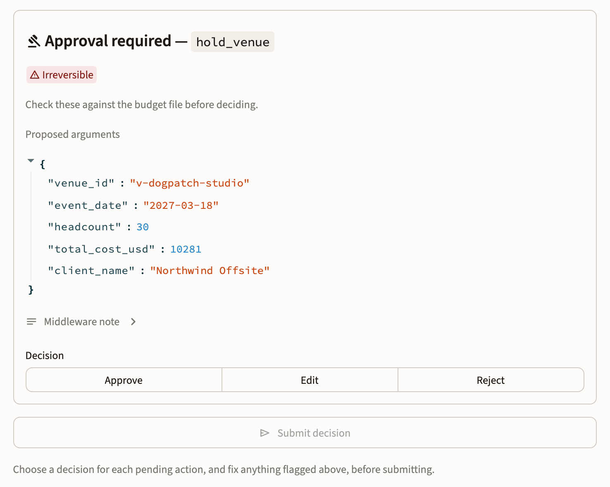

# Event Planner Agent

[](https://github.com/darylalim/event-planner-agent/actions/workflows/ci.yml)

Event planning agent on [Deep Agents](https://docs.langchain.com/oss/python/deepagents/overview).

Takes an event brief and drives it to a bookable plan — venue shortlist,
catering and AV, budget, run-of-show — delegating research to subagents,
keeping durable artifacts on disk, and pausing for human approval before
anything spends money or reaches a guest's inbox.

## Why Deep Agents

Event planning hits nearly every condition the harness exists for:

| Capability | Why this task needs it |
| --- | --- |
| Planning (`write_todos`) | Headcount gates venue, venue gates catering, venue gates run-of-show |
| File management | Guest lists and vendor quotes outgrow a context window |
| Subagent delegation | Comparing eight venues shouldn't pollute the orchestrator's context |
| Persistent memory | Planning spans days or weeks of separate sessions |

`create_deep_agent` returns a compiled LangGraph graph, so checkpointers,
`interrupt()`, streaming, and Studio all still work underneath.

## What's real and what's stubbed

| Component | Status |
| --- | --- |
| `web_search` | **Live** (Tavily) |
| `estimate_budget` | **Real** arithmetic — reproducible and auditable |
| `search_venues`, `check_availability`, `search_vendors` | Stubbed, deterministic |
| `hold_venue`, `send_invitations` | Stubbed — return a reference, take no action |

Stubs are deterministic on purpose: a regression in agent behaviour should be
visible, not blamed on a vendor API. The tool signatures are the contract the
prompts are written against, so keep them stable when swapping in real
backends.

## Quickstart

Requires [uv](https://docs.astral.sh/uv/).

```bash
uv sync
cp .env.example .env   # then fill in ANTHROPIC_API_KEY
uv run event-planner
```

If `uv sync` reports a uv version mismatch, run `uv self update <version>` with the
version it names. `TAVILY_API_KEY` is optional: without it, `web_search` tells the
agent to rely on the structured directory and flag what went unchecked.

## Running it

```bash
uv run event-planner                                  # interactive CLI
uv run event-planner --user alice@example.com         # scoped memory
uv run event-planner --thread offsite-2026            # named conversation
uv run event-planner --max-steps 400                  # longer planning session
uv run event-planner --model claude-opus-5 --effort xhigh   # orchestrator only
uv run streamlit run streamlit_app.py                 # browser UI
uv run --with "langgraph-cli[inmem]" langgraph dev    # LangGraph Studio
```

In the CLI: `/state` lists what is stored for the current user, `/export` writes
their event files to `exports/`, and `/exit` quits.

Both front ends read the same `.env` and share `.state/planner.sqlite` unless
`EVENT_PLANNER_DB` points elsewhere, so a plan started in the terminal resumes
in the browser on the same thread.

## How it works

```
orchestrator (claude-opus-5-5, high effort)
├── tools      search_venues · check_availability · search_vendors
│               estimate_budget · hold_venue* · send_invitations*
├── subagents  venue-researcher · vendor-researcher   (claude-sonnet-5-5, medium)
│               budget-analyst                        (claude-sonnet-5-5, high)
├── skills     venue-sourcing · budget-modeling        (loaded on demand)
└── memory     /memories/AGENTS.md                     (loaded every turn)

                                        * gated behind human approval
```

The orchestrator takes the brief and delegates research to subagents, which write
their findings to per-user storage and report back. It holds the booking tools, and
the graph stops for a human decision before either one runs. See
[Architecture](docs/architecture.md) for the reasoning.

<picture>
  <source media="(prefers-color-scheme: dark)" srcset="docs/images/approval-panel-dark.png">
  
</picture>

*The browser UI's approval panel, shown with sample data.*

## Safety in brief

- **Approval gates.** `hold_venue` and `send_invitations` wait for `approve`, `edit`
  or `reject`, and `build_agent` refuses to build without the checkpointer they need.
- **Per-user storage.** Memories, event files and offloaded results are namespaced
  per user. The shared filesystem root holds only skills and refuses writes.
- **No web access beside the booking tools.** `web_search` belongs to the two
  researchers, so the agent that can book never reads arbitrary web pages.
- **No authentication.** The user id names a tenant but doesn't prove one, so keep
  the Streamlit page on loopback. It binds to `127.0.0.1` and warns if it doesn't.
- **Tracing leaves the machine.** With LangSmith on, every prompt and tool result
  goes to one project, outside per-user isolation.

## Development

```bash
uv run pytest                                         # harness tests
uvx ruff check .                                      # lint
uvx ruff format .                                     # format
uvx ty check                                          # types
uv run scripts/live_check.py brief --yes-spend        # LIVE check, ~$0.65-$1
```

`main` requires a pull request and passing CI, so every change goes through a branch.

## Documentation

- [Architecture](docs/architecture.md): storage, tenant isolation, approvals, step
  budget, tracing, the browser front end and the file layout.
- [Verified live](docs/verified-live.md): recorded runs against the real model,
  including costs and the evaluation baseline.
- [Development](docs/development.md): toolchain pins, API keys and contributing.
- [Releases](docs/releases.md): how a version bump becomes a release.
- [Notes on `deepagents`](docs/deepagents-notes.md): where its docs and the installed
  package disagree.
- [Plans](docs/plans/README.md): what's done and what's next.

## License

[MIT](LICENSE).
